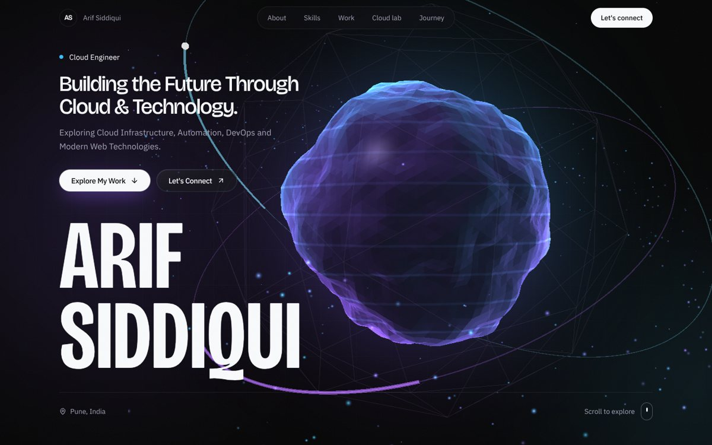
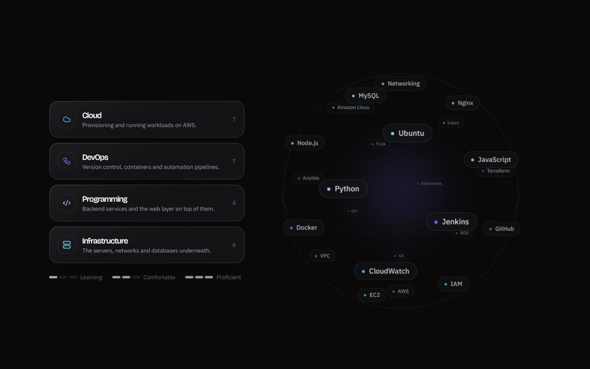
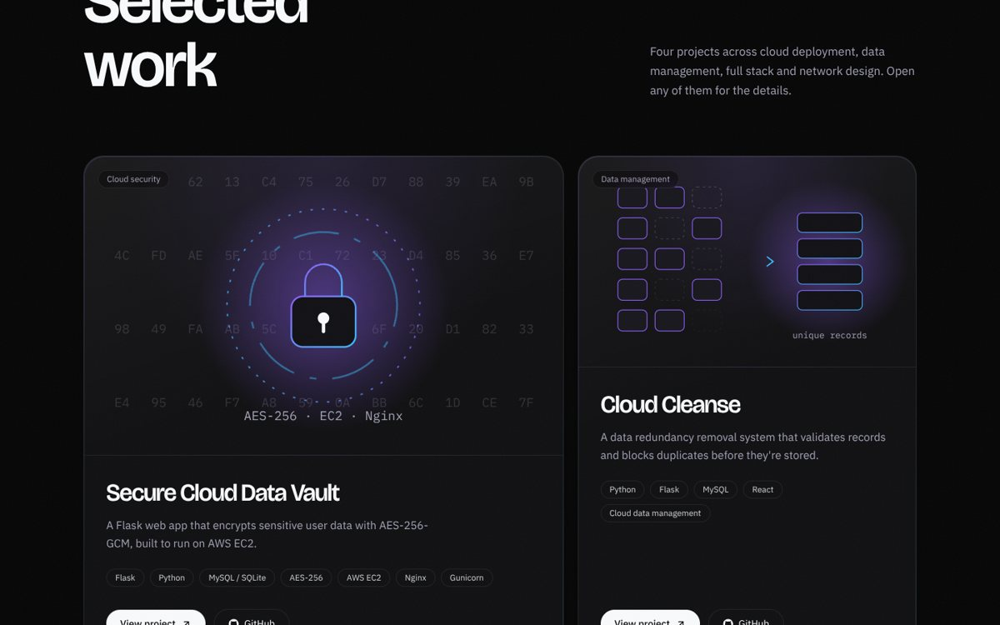
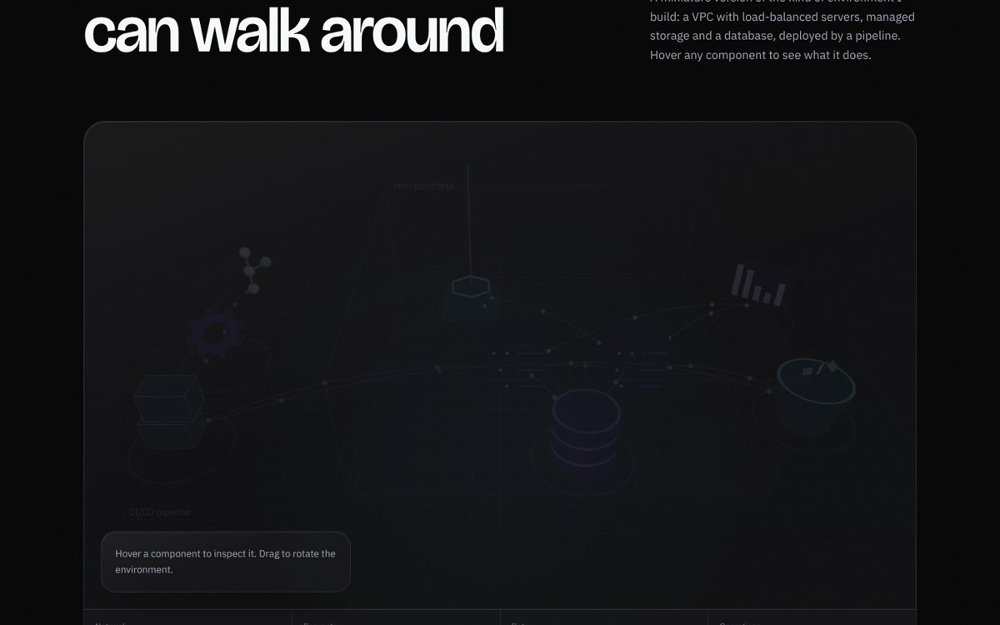
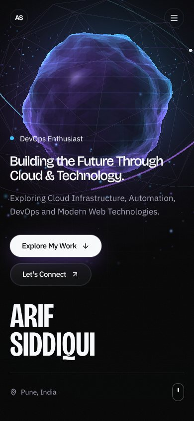

# Arif Siddiqui — 3D Portfolio

Personal portfolio of **Arif Siddiqui**, MCA student specialising in Cloud
Computing (Pune, India) — Cloud Engineer · DevOps Enthusiast · Full Stack Developer.

An immersive, fully animated single-page site: a shader-driven 3D hero, a
draggable skills globe, interactive project case studies and an explorable 3D
model of a cloud environment.



## Features

- **3D hero** — a custom GLSL "data core": simplex-noise surface displacement,
  pointer-reactive dent, fresnel lighting, orbiting particle field and packet
  rings, mouse parallax and a cinematic scroll exit.
- **Intro sequence** — load counter tied to real page readiness, then a
  letter-by-letter name reveal.
- **Skills globe** — 24 technologies on a rotating 3D sphere (CSS 3D
  transforms), steerable by pointer or drag, with honest, configurable skill levels.
- **Project case studies** — tilt cards with pointer glare, animated SVG
  previews, and an accessible dialog with details and GitHub links.
- **Cloud lab** — a React Three Fiber scene of a VPC, load balancer, EC2
  servers, RDS, S3, CloudWatch and a Git → Jenkins → Docker/Terraform pipeline,
  with data packets flowing between components. Hover any part for an explanation.
- **Timeline** — scroll-drawn experience and learning path, driven by a data file.
- **Contact** — validated form with spam honeypot, email delivery through
  Resend (optional) and a mail-app fallback that works with zero configuration.
- Smooth scrolling (Lenis) synced with GSAP ScrollTrigger, magnetic buttons,
  custom cursor, and a section-aware navigation bar.

| Skills | Projects |
| --- | --- |
|  |  |

| Cloud lab | Mobile |
| --- | --- |
|  |  |

## Tech stack

| Area | Tools |
| --- | --- |
| Framework | Next.js 15 (App Router), React 19, TypeScript |
| Styling | Tailwind CSS v4, self-hosted variable fonts |
| 3D | Three.js, React Three Fiber, Drei, custom GLSL shaders |
| Motion | GSAP + ScrollTrigger, Framer Motion, Lenis |
| Icons | Lucide React |
| Hosting | Vercel (with automatic GitHub deployments) |

## Getting started

Requires **Node.js 18.18 or newer** (Node 22 recommended — see `.nvmrc`).

```bash
git clone https://github.com/arifalisiddiqui36-blip/arif-siddiqui-3d-portfolio.git
cd arif-siddiqui-3d-portfolio
npm install
npm run dev
```

Open http://localhost:3000.

| Command | What it does |
| --- | --- |
| `npm run dev` | Start the development server |
| `npm run build` | Create a production build |
| `npm start` | Serve the production build locally |
| `npm run lint` | Run ESLint |

## Updating content

All content lives in `src/data/` — no component changes needed.

| File | Controls |
| --- | --- |
| `site.ts` | Name, roles, headline, education, email, LinkedIn / GitHub links |
| `skills.ts` | Skill list and levels (`learning`, `comfortable`, `proficient`) |
| `projects.ts` | Project text, tech stack, GitHub and live-demo links |
| `timeline.ts` | Education, internships and certifications (templates included) |
| `infra.ts` | Labels and explanations in the 3D cloud lab |

Links left empty are hidden automatically, so the site never shows a dead button.

## Project structure

```
src/
├── app/
│   ├── layout.tsx            # fonts, SEO metadata, JSON-LD
│   ├── page.tsx              # section composition
│   ├── api/contact/route.ts  # contact form endpoint
│   ├── opengraph-image.tsx   # generated social preview image
│   ├── sitemap.ts, robots.ts
│   └── globals.css           # design tokens and base styles
├── components/
│   ├── providers/            # Lenis ↔ GSAP sync, intro state
│   ├── three/                # HeroScene, InfraScene, GLSL shaders
│   ├── sections/             # Hero, About, Skills, Projects, Infrastructure, Journey, Contact
│   └── ui/                   # Loader, Nav, Cursor, MagneticButton, SectionHeader, …
├── data/                     # all editable content
├── fonts/                    # Bricolage Grotesque, IBM Plex (SIL OFL)
└── lib/hooks.ts              # media queries, reduced motion, in-view, performance tier
docs/                         # README screenshots
```

## Environment variables

None are required. Copy `.env.example` to `.env.local` only if you need them.

| Variable | Purpose |
| --- | --- |
| `NEXT_PUBLIC_SITE_URL` | Canonical URL. Optional on Vercel — the production domain is detected automatically. Set it for a custom domain. |
| `RESEND_API_KEY` | Enables email delivery from the contact form ([resend.com](https://resend.com)). Without it, the form opens the visitor's mail app. |
| `CONTACT_TO_EMAIL` | Inbox that receives messages (defaults to the email in `site.ts`). |
| `CONTACT_FROM_EMAIL` | Sender address on a domain verified in Resend. |

## Deploying to Vercel

1. Sign in at [vercel.com](https://vercel.com) with GitHub.
2. **Add New → Project**, then import `arif-siddiqui-3d-portfolio`.
3. Keep the detected settings: framework **Next.js**, root directory `./`,
   build command `npm run build`, output handled by Next.js.
4. Add any environment variables from the table above (optional).
5. Click **Deploy**.

After the first deploy, every push to `main` ships to production and every
other branch or pull request gets its own preview URL.

## Performance and accessibility

- Both 3D scenes are code-split (`next/dynamic`, client-only); the cloud lab
  loads only as it approaches the viewport, and render loops pause off-screen.
- Lower particle counts, geometry detail and pixel ratio on phones and
  low-core devices; a static fallback when WebGL is unavailable.
- `prefers-reduced-motion` disables the intro, smooth scrolling, scroll
  scrubbing and the custom cursor, and slows 3D motion.
- Skip link, visible focus states, a keyboard-operable list for every 3D
  component, and a focus-trapped project dialog that closes with Escape.

## License

Code © Arif Siddiqui. Fonts in `src/fonts/` are licensed under the SIL Open
Font License (see the included license files).
